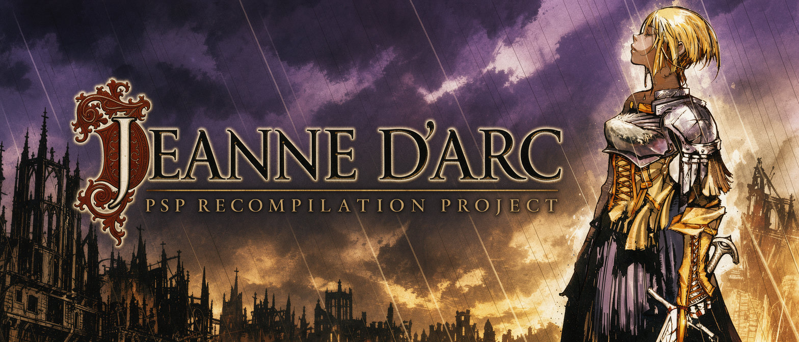

# JDARCRECOMP



A native PC (Windows/Linux) and Android port of the PSP game *Jeanne d'Arc*,
built by static recompilation and progressive decompilation.

**This repository contains no game code or assets.** You need your own copy of the game
(UCUS98700, USA). Everything derived from it is generated locally and never committed.

## Status

Boots through the opening movie to the title screen, and NEW GAME reaches the `DEMO0000`
cutscene and the village dialog beyond it, with text rendered by the substitute-font
HLE. Media and code details live in [docs/formats.md](docs/formats.md) and
[docs/decompilation.md](docs/decompilation.md).

## Requirements

- Your own `game.iso` (UCUS98700). Its SHA-1 is recorded in `.recomp.json` so you can check your copy:
  `sha1sum game.iso` should print `87b0e5fdbadaa0741adf5a5007d25d51639e6f9e`.
- CMake ≥ 3.25, Ninja, LLVM/Clang (and the Vulkan SDK, slangc). On Windows, also Visual Studio 2022
  (for the Windows SDK and CRT used by `clang-cl`).
- FFmpeg with the SVT-AV1 and Vorbis encoders (movie cooking is a required build step).

## Building

First checkout: `git submodule update --init --recursive`. Then follow these steps in order:

1. Extract your disc once (the game runs from the folder, never from the ISO):

```
7z x game.iso -odata/original PSP_GAME UMD_DATA.BIN
```

2. Recompile it to C (output goes to the git-ignored `data/generated/` and is picked up by the build;
see [docs/decompilation.md](docs/decompilation.md)):

```
build/linux-x64-debug/psprecore/tools/psprecomp/psprecomp data/original/PSP_GAME/SYSDIR/BOOT.BIN data/generated --overrides src/decomp --seeds seeds.txt
```

3. Build with the wrapper scripts:

```
scripts/build.sh                              # Linux: linux-x64-debug, build + tests
scripts/build.sh --preset linux-x64-release --no-test
scripts/build.sh --preset linux-x64-debug --target jdarc   # single target
scripts\build.ps1 -Preset windows-x64-release -NoTest   # Windows (sets up the VS environment itself)
```

The `jdarc` game target appears only after step 2; before that, the build still
produces `jdcook`, `psprecomp`, `psprx`, `psptex` and the format/tests targets.

4. Cook the movie media the game loads besides the disc (required — without it movies play
black and silent). PSMF video becomes AV1/IVF and its ATRAC3plus audio becomes Ogg:

```
scripts/cook.sh                              # data/original -> data/cooked
scripts/cook.sh -- --force --limit 1         # re-cook, or trial-run the first movie
scripts\cook.ps1                             # Windows
```

5. Run the game (settings, saves: the working directory):

```
scripts/run.sh                              # the repository's layout (run/ as cwd)
scripts/run.sh -- --replay ../data/recordings/boot.txt --unthrottled
```

Or invoke the binary directly: `build/linux-x64-release/jdarc data/original --cooked data/cooked`.

Android: `scripts/build-android.sh --install` builds and installs the APK (arm64, NDK r29);
`--install-data` copies the game and `data/cooked` to the device. Logs go to logcat (tag `jdarc`).
